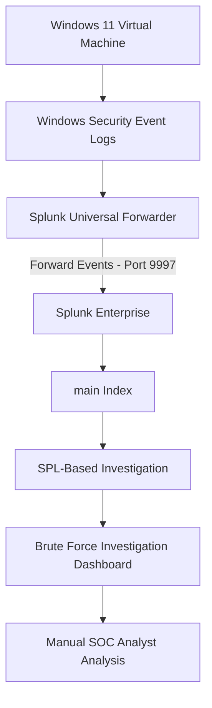

# Brute Force Attack Simulation and Investigation Using Splunk Enterprise

## 1. Project Overview

This project demonstrates a practical brute-force attack simulation and manual Security Operations Center (SOC) investigation using Splunk Enterprise.

Failed and successful Windows authentication events are generated in a Windows 11 virtual machine, collected through Splunk Universal Forwarder, and ingested into Splunk Enterprise for security monitoring and investigation.

The project focuses on identifying repeated failed login attempts, login bursts, suspicious account activity, and authentication patterns using Splunk Search Processing Language (SPL).

## 2. Project Objectives

- Simulate failed and successful Windows login attempts.
- Collect Windows Security Event Logs.
- Forward security events to Splunk Enterprise.
- Investigate authentication events using SPL.
- Identify potential brute-force activity.
- Build a security investigation dashboard.
- Practice manual SOC analyst investigation techniques.

## 3. Environment & Lab Setup

| Component | Configuration |
|---|---|
| Host Machine | MacBook Air M1 |
| Virtualization | UTM |
| Virtual Machine | Windows 11 |
| SIEM Platform | Splunk Enterprise 10.4.2 |
| Log Collector | Splunk Universal Forwarder |
| Log Source | Windows Security Event Logs |
| Splunk Receiving Port | 9997 |
| Index | main |
| Event IDs | 4624, 4625 |

### Network Configuration

| Machine | Configuration |
|---|---|
| Host Machine | MacBook Air M1 |
| Virtual Machine | Windows 11 |
| Communication | Host-to-VM network connectivity |
| Splunk Receiving Port | 9997 |

## 4. Architecture

### Architecture Workflow

1. Windows 11 VM generates Windows Security authentication events.
2. Splunk Universal Forwarder collects Security Event Logs.
3. The events are forwarded to Splunk Enterprise through port 9997.
4. Splunk Enterprise indexes the incoming events in the `main` index.
5. SPL queries are used to investigate authentication activity.
6. Investigation results are presented through a Splunk dashboard.
7. A SOC analyst reviews the findings.

## 5. Attack Simulation

A controlled brute-force login attempt simulation was performed in the Windows 11 virtual machine.

The generated authentication events were investigated using the following Windows Security Event IDs:

| Event ID | Description |
|---|---|
| 4625 | Failed Logon |
| 4624 | Successful Logon |

## 6. Splunk Investigation Dashboard

**Dashboard Name:** Brute Force Attack Investigation Dashboard

The dashboard contains the following investigation panels.

### 6.1 Potential Brute Force Detection

**Purpose:** Identify accounts with repeated failed login attempts.

### 6.2 Failed vs Successful Login Comparison

**Purpose:** Compare failed and successful authentication activity.

**Event IDs:** 4624 and 4625.

### 6.3 Brute Force Attack Timeline

**Purpose:** Analyze failed login activity over time and identify periods of increased authentication failures.

### 6.4 Repeated Failed Login Detection

**Purpose:** Identify accounts with repeated failed login attempts on the same host.

### 6.5 Failed Login Burst Detection

**Purpose:** Identify multiple failed login attempts occurring within a short time interval.

### 6.6 Multiple Account Brute Force Detection

**Purpose:** Investigate failed login activity across multiple accounts and identify accounts with high failure counts.

### 6.7 Failed Login by Logon Type

**Purpose:** Analyze failed authentication events based on Windows logon types.

### 6.8 Failed Login by Source IP

**Purpose:** Examine the source network addresses associated with failed authentication attempts.

## 7. Tools & Technologies

- Splunk Enterprise
- Splunk Universal Forwarder
- Windows 11
- UTM Virtualization
- Windows Event Viewer
- SPL (Search Processing Language)
- Mermaid Architecture Diagram

## 8. Investigation Summary

This project demonstrates the collection, ingestion, and manual investigation of Windows authentication events using Splunk Enterprise.

It provides practical experience in Windows Security Log Analysis, authentication monitoring, brute-force detection concepts, SPL queries, and SOC investigation workflows.

## 9. Conclusion

The project demonstrates how Windows Security Event Logs can be collected and investigated using a SIEM platform.

It provides hands-on practice in identifying suspicious authentication activity and analyzing security events from a SOC analyst perspective.
